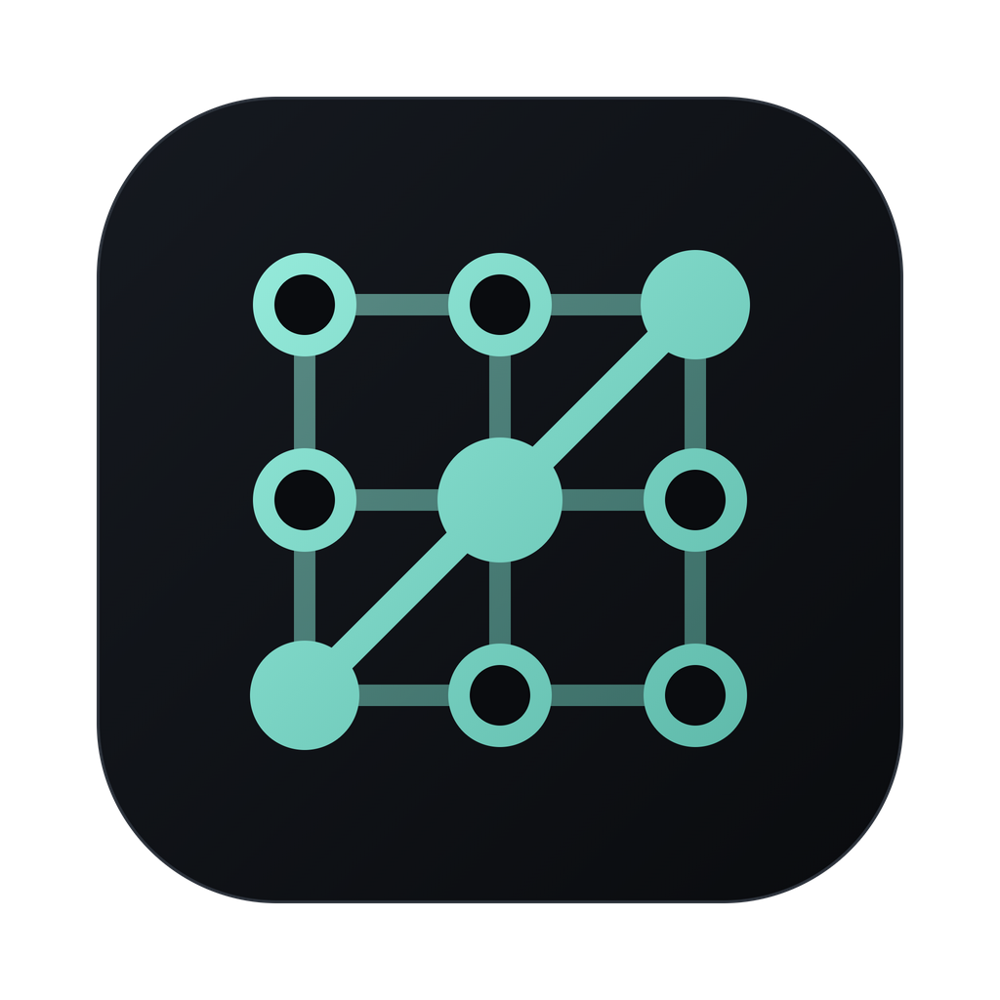

<p align="center">
  
</p>

<h1 align="center">Lattiz</h1>

<p align="center">
  <a href="https://github.com/kornel77777/lattiz/releases/latest"><strong>Download for macOS</strong></a>
  &nbsp;·&nbsp;
  <a href="docs/privacy.md">Privacy</a>
  &nbsp;·&nbsp;
  <a href="LICENSE">MIT license</a>
</p>

Mission control for your coding agents. Run Claude Code, Codex, Gemini CLI and others side by side, see at a glance which one is working, which one needs you and which one is done, and review and land their work safely.

Lattiz doesn't replace your agents and has no account of its own. It runs the agent CLIs you already have, on your own sign-ins and subscriptions.

## What it does

- **Every agent in one place.** Tile chats in the lattice, or lay them out on a zoomable canvas grouped by project. Built in: Claude Code, Codex, Gemini CLI, Copilot CLI, OpenCode, Grok CLI and Aider. Add more by dropping a JSON manifest in the agents folder.
- **Status and attention.** Working, needs-you and done for every chat. An Inbox collects approvals and questions from all agents, with native notifications and Ctrl+J to jump to the next one.
- **Safe changes.**
  - Each chat can work in its own git worktree, and every turn is checkpointed with undo and a timeline.
  - The Review Inbox shows diffs hunk by hunk.
  - Merges are dry-run first.
- **Guardrails.** Permission modes per chat, and an always-ask list (for example `git push`, `rm -rf`) that holds those commands for your approval even in Full-auto.
- **Orchestration.** A Conductor chat can start other chats, wait for them and summarise their work. Flows chain agents into reviews, pipelines and scheduled jobs. Cards are small sandboxed dashboards.
- **The rest:** a terminal dock, a browser dock with an element picker, ⌘K for everything (including what was said), send later and handoff to another agent when one hits its limit.

## Claude in Lattiz

| In the "New chat" menu | What it is                                                                                                                                               | Billing                                         |
| ---------------------- | -------------------------------------------------------------------------------------------------------------------------------------------------------- | ----------------------------------------------- |
| **Claude Code**        | Your own `claude` in its own terminal, inside a Lattiz tile. Lattiz adds hooks for status, Inbox approvals, the always-ask list, checkpoints and resume. | Your Claude subscription                        |
| **Claude**             | Lattiz's chat view (inline diffs, steering, broadcast) on Anthropic's Agent SDK                                                                          | An Anthropic API key, billed per use. Optional. |

Anthropic doesn't allow third-party apps to offer Claude subscription login in their own UI, so the chat view needs an API key. Claude Code in its terminal is the usual way to use a subscription.

## Install

Releases are for **macOS on Apple Silicon** (M1 and newer) for now. Windows, Linux and Intel Macs will follow. Until then, you can [build from source](#build-from-source) on those.

1. Download the `.dmg` from the latest [release](https://github.com/kornel77777/lattiz/releases).
2. Open it and drag Lattiz to Applications.
3. The app isn't code-signed yet. On first launch, if macOS says it can't check it, open System Settings → Privacy & Security and click **Open Anyway**.

Lattiz shows a notice in its status bar when a newer release is out.

**You'll also need** at least one agent CLI, installed and signed in. For example:

```sh
npm install -g @anthropic-ai/claude-code   # then: claude
npm install -g @openai/codex               # then: codex login
npm install -g @google/gemini-cli          # then: gemini
```

Settings → Agents shows what Lattiz found and has a sign-in button for each. Without any agent, the built-in demo agent still lets you try things out.

## Privacy

There's no Lattiz account or server and no analytics. Your agents talk to their own providers exactly as they do in a terminal. Logs and crash reports stay on your computer. The full list of what leaves your machine is in [docs/privacy.md](docs/privacy.md), and it's also in Settings → Data.

## Build from source

```sh
corepack enable && pnpm install
pnpm dev                 # run with hot reload
pnpm check               # format, lint, types, unit and native tests
pnpm --filter @lattiz/desktop e2e     # end-to-end tests (Playwright + Electron)
pnpm --filter @lattiz/desktop package # an unpacked app in apps/desktop/release/
```

Running from source, the Claude chat view may also use your own Claude sign-in. A personal build keeps that with `LATTIZ_PERSONAL=1 pnpm --filter @lattiz/desktop package`.

## For contributors

- **The plan:** [`docs/dev/SPEC.md`](docs/dev/SPEC.md).
- **Where things stand:** [`docs/dev/PROGRESS.md`](docs/dev/PROGRESS.md).
- **Choices along the way:** [`docs/dev/DECISIONS.md`](docs/dev/DECISIONS.md).
- **How each agent is integrated (verified against the real CLIs):** `docs/adapters/`.
- **Releases:** pushing a tag like `v0.2.0` builds installers into a draft GitHub release (`.github/workflows/release.yml`).

## License

[MIT](LICENSE) © 2026 Kornel Omori
